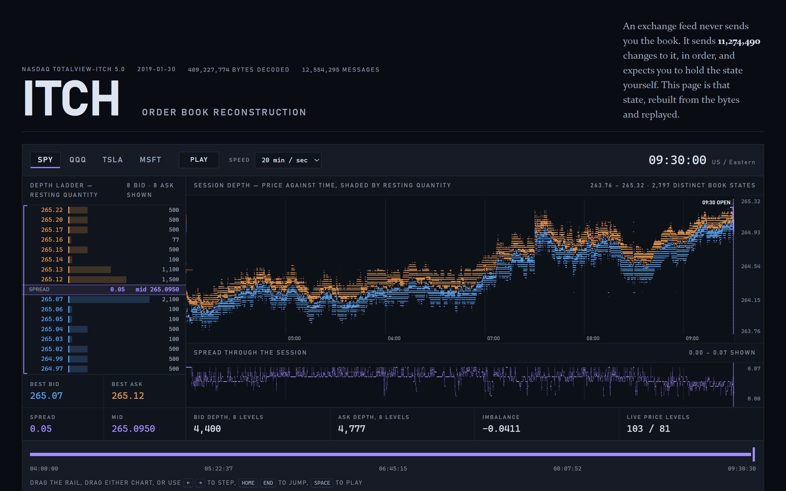

# ITCH Decoder

[](https://github.com/rawatneelmayank1-sire/itch-decoder/actions/workflows/ci.yml)

**Live demo: [rawatneelmayank1-sire.github.io/itch-decoder](https://rawatneelmayank1-sire.github.io/itch-decoder/)**
-- scrub or play through the reconstructed Nasdaq order book for SPY, QQQ, TSLA and MSFT,
rebuilt from 12,554,295 real exchange messages. It is a static page: no server, nothing to
install.

[](https://rawatneelmayank1-sire.github.io/itch-decoder/)

A NASDAQ TotalView-ITCH 5.0 binary decoder, limit order book reconstructor, and
analytics pipeline, in Python.

It reads the exchange's raw binary feed, rebuilds every symbol's full limit order book
from it, and then **proves the reconstruction is correct** by cross-checking it against
the exchange's own execution reports.

---

## Why order book reconstruction is necessary at all

The exchange does not broadcast the state of the book. It broadcasts **changes**.

ITCH is a delta feed. There is no message that says "the book for AAPL is now these
prices at these sizes". There is `Add Order: reference 9005, 600 shares, $107.26`, and
then some milliseconds later `Order Executed: reference 9005, 100 shares`, and later
still `Order Delete: reference 9005`. Nothing else. To know the spread at 09:31:04.212
you must have applied every single one of the preceding messages, in order, correctly.

That reconstruction is the entire exercise. The decoder is plumbing; the book is the
product. And because there is no state message to compare against, the interesting
engineering question is not "does it run" but **"how would you ever know it was right?"**
Section [Correctness](#correctness-the-oracle) is the answer this project gives.

---

## Data

**The measurements below come from real NASDAQ exchange data**, not from a simulation.

| | |
| --- | --- |
| Source | `emi.nasdaq.com/ITCH/Nasdaq ITCH/01302019.NASDAQ_ITCH50.gz` (Nasdaq's free historical sample) |
| Trading day | 2019-01-30 |
| Full file | 4.76 GB gzip, ~11 GB uncompressed |
| **What I actually processed** | **the first 409,227,774 bytes = 12,554,295 messages** |
| Time span covered | **04:00:00.000 to 09:30:30 US/Eastern** -- the complete pre-market session and the opening cross |
| Symbols | 8,713 in the stock directory; 8,693 with order-book activity |

Downloading 4.76 GB at the ~1 MB/s the server gave me was not practical, so I fetched a
**byte-range prefix**. gzip is a stream format, so a prefix of the compressed file decodes
to a valid prefix of the underlying ITCH byte stream: real exchange messages, simply
truncated in time. The prefix is cut at a whole-message boundary. `tools_download.py` does
this and is resumable.

Because the file begins at the true start of the session (System Event `O`), **the book is
built from a cold, empty start with no warm-up gap** -- which is what makes the 100%
reference-resolution result below meaningful rather than lucky.

**The data is not in this repository** and must not be committed. `.gitignore` excludes
every real capture (`*.itch`, `*.gz`) and everything else in `data/`, except the provenance
notes, two small stats files, and the hand-built test vectors in `data/fixtures/`. Fetch the
real data with `python tools_download.py`; [`data/PROVENANCE.md`](data/PROVENANCE.md)
records exactly what was downloaded and how to rebuild every file.

A **synthetic generator** (`itch.generator`) emits byte-exact, spec-conformant ITCH 5.0.
It is used for the test suite and CI (which has no 4.8 GB download) and as a *positive
control* for the oracle: the synthetic stream is coherent by construction, so agreement on
it must be 100%, and anything less is a bug in the book rather than in the data. Every
number in this README is labelled with which data it came from.

---

## Results

### Layout conformance

Before any of the behavioural results below mean anything, the field layouts have to be
right. Every message layout in `messages.py` was checked field by field against
[`docs/itch-5.0-spec.md`](docs/itch-5.0-spec.md), an engineering reference (offsets, lengths,
widths) derived from the official *Nasdaq TotalView-ITCH 5.0* specification PDF:

- **All 22 message lengths** stated in the spec match `MESSAGE_LENGTHS` exactly.
- **All 10 decoded message types match field for field** -- every offset, every width,
  87 fields in total (S 5, R 18, A 9, F 10, E 7, C 9, X 6, D 5, U 8, P 10).

`messages._validate_layouts()` re-asserts the lengths at import time, so a layout that
drifts from the spec is an `ImportError`, not a wrong number in a chart three hours later.

### Correctness (the oracle)

Full run over all 409 MB / 12.55M real messages:

| check | result |
| --- | ---: |
| Executions cross-checked (`E` + `C`) | **63,577** |
| Order references resolved to a resting order | **63,577 / 63,577 = 100.0000%** |
| Executions occurring at our reconstructed touch price | **63,577 / 63,577 = 100.0000%** |
| Executions away from the touch (would prove us wrong) | **0** |
| Resting side empty at execution time | **0** |
| Executions demanding more shares than were resting | **0** |
| Crossed-book snapshots (of 32,790 taken) | **0** |
| Cancels / deletes / replaces of unknown references | **0** |

**What the 100% agreement rate actually claims.** Nasdaq matches with strict price
priority, so an execution against a *displayed* buy order resting at price P proves that
no better-priced displayed bid existed at that instant. For every one of the 63,577
executions in this data, our reconstructed book independently reported that same price as
its best bid (or best ask, for sells) **immediately before the message was applied**. Had
the book been wrong about a single price level, an ordering, or a quantity, the touch
would have disagreed and the count would not be 63,577.

This is a check against a statement the exchange made, not against another part of my own
code.

### Throughput

All figures below are medians of repeated timed trials after discarded warm-ups, measured
on this machine. Full matrix, method, and environment: **[`results/benchmarks.md`](results/benchmarks.md)**,
regenerable with `python -m itch bench`.

Full-scale run, real data (409,227,774 bytes / 12,554,295 messages):

| stage | time | rate |
| --- | ---: | ---: |
| Vectorised decode | 7.73 s | **1,623,790 messages/sec** |
| Order book replay of 11,274,490 events, oracle checks on | 38.51 s | **292,751 events/sec** |

(These two are single timed runs of the whole 409 MB pipeline, recorded in
`results/pipeline_summary.json`. The repeated-trial figures below are the ones to quote
for the decoder itself; whole-pipeline timings vary a few percent run to run.)

Naive vs vectorised decode, median of 5 timed trials after a discarded warm-up:

| workload | decoded records | naive | vectorised | speedup |
| --- | ---: | ---: | ---: | ---: |
| real 5 MB | 8,714 | 99,899/s | 142,753/s | 1.43x |
| real 25 MB | 652,559 | 383,129/s | 1,579,815/s | 4.12x |
| **real 100 MB** | **3,230,304** | **392,151/s** | **1,791,300/s** | **4.57x** |
| synthetic 50,000 msgs | 50,007 | 458,107/s | 1,866,114/s | 4.07x |
| synthetic 250,000 msgs | 250,007 | 412,958/s | 1,785,447/s | 4.32x |
| synthetic 1,000,000 msgs | 1,000,007 | 349,131/s | 1,651,085/s | 4.73x |

Rates are **decoded records** per second, not frames. Neither decoder builds records for
message types outside the ten it decodes; those are walked and skipped. That matters
because the opening megabytes of a real ITCH file are almost entirely setup messages --
the 5 MB slice contains only 8,714 decodable records out of 176,703 frames, so it is
essentially a pure framing-scan benchmark, and its 1.43x is the honest floor rather than
an anomaly. Quoting frames per second instead would have flattered the naive decoder on
exactly that slice.

Order book replay, including all oracle checks: **523,987 events/sec** on the real 100 MB
slice (3,221,588 events), **362,148 events/sec** on 1M synthetic messages.

**Where the vectorised decode's time actually goes** (100 MB real slice):

| | |
| --- | ---: |
| Framing scan (the residual Python loop) | 0.991 s |
| Total vectorised decode | 1.777 s |
| **Scan share of total** | **55.7%** |

So after vectorising field extraction, **more than half the remaining time is the
sequential framing scan** -- Amdahl's law made concrete. It cannot be vectorised: a
record's length is only knowable once you are positioned at its start, so message offsets
form a *chain*, not an arithmetic sequence, and no `cumsum` produces them. Further NumPy
work on extraction would buy almost nothing; the honest next step is a C extension for the
scan. DESIGN.md §6 covers the two alternatives I considered and rejected.

### Charts

Committed to [`results/`](results/), regenerable with `python -m itch analyse`.

| chart | what it shows |
| --- | --- |
| [`spread_curve.png`](results/spread_curve.png) | Quoted spread per symbol, 04:00-09:30. Log y-axis: spreads span three orders of magnitude across this window. |
| [`depth_imbalance.png`](results/depth_imbalance.png) | Top-5 depth on each side, and the resulting book imbalance, for the most-sampled symbol. |
| [`message_distribution.png`](results/message_distribution.png) | Message-type census. Log x-axis, because the distribution spans six decades. |
| [`top_symbols.png`](results/top_symbols.png) | The 25 busiest symbols by order-book message count. |
| [`spread_vs_activity.png`](results/spread_vs_activity.png) | Median spread against message traffic, both log. |

### What the data says

A few things that fall out of the run, all from `results/analysis_summary.json`:

- **Message traffic is overwhelmingly quote churn, not trading.** Across 12.55M messages,
  `A` (4,745,681) + `D` (4,015,409) + `X` (1,084,447) + `U` (661,033) -- adds, deletes,
  cancels and replaces -- account for ~83% of the feed. Actual executions (`E` + `C`) are
  63,577, about **0.5%**. Orders are posted and pulled far more often than they trade. This
  is the single most important structural fact about a modern equity feed, and it is why
  `cancel` being O(1) is the design decision that matters most.

- **The busiest symbols in this window are all European ADRs**: RDS.B, SAP, RDS.A, UN,
  ASML, RIO, NVS, BBL, VOD, DEO. That is not noise -- this window is 04:00-09:30 ET, when
  European markets are open and their US listings are being arbitraged against the primary
  listings. The busiest names in a pre-market window are exactly the ones with a live
  overseas price to track.

- **Pre-market spreads are wide and converge into the open.** Median quoted spread across
  tracked symbols: QQQ $0.030, AMD $0.040, SPY $0.050, AAPL $0.11, MSFT $0.22, TSLA $0.39.
  TSLA's spread reaches ~$33 around 05:00, when almost nothing is quoting, and tightens by
  two orders of magnitude by 09:30.

- **`I` (Net Order Imbalance Indicator) messages number 1,051,216** -- more than 8% of the
  feed -- because this window is dominated by the run-up to the opening cross. The 8,713 `Q`
  (Cross Trade) messages are one per symbol: the opening auction prints at 09:30.

---

## Architecture

```
ITCH file (big-endian, length-prefixed binary records)
      |
      |  decoder.py         naive: one struct.unpack per message  [correctness reference]
      |  fast_decoder.py    vectorised: framing scan + NumPy structured-dtype gather
      v
DecodedBatch  (per-type columnar NumPy arrays + stream-order index)
      |
      |  fast_decoder.book_events()   flatten + re-interleave into strict stream order
      v
book events (one flat structured array; optionally filtered to one symbol)
      |
      |  replay.py          apply in order, snapshot on a schedule, cross-check the oracle
      |  book.py            dict[price] -> PriceLevel -> intrusive doubly-linked order list
      v
MultiBook + OracleReport + Snapshots
      |
      |  store.py           batched inserts, one transaction
      v
SQLite  (runs, symbols, book_snapshots, message_counts, symbol_activity, oracle_report)
      |
      |  analyse.py         pandas + matplotlib
      v
results/*.png  +  results/*.json
```

| module | responsibility |
| --- | --- |
| `messages.py` | Spec layouts for all 23 message types, `struct` formats and NumPy dtypes, import-time layout assertions |
| `docs/itch-5.0-spec.md` | Layout reference derived from the official ITCH 5.0 spec, used to verify every layout |
| `decoder.py` | Naive per-message decoder. The correctness reference the fast path is tested against |
| `fast_decoder.py` | Vectorised columnar decoder; frame scan; stream-ordered event flattening |
| `generator.py` | Independent byte-exact ITCH encoder + coherent synthetic stream |
| `book.py` | `OrderBook`, `PriceLevel`, `OrderNode`, `MultiBook`, invariant checker |
| `replay.py` | Stream replay, periodic snapshots, the correctness oracle |
| `store.py` | SQLite schema and batched loaders |
| `analyse.py` | pandas analysis and matplotlib charts |
| `bench.py` | Benchmark harness with warm-ups, repeated trials, median + spread |
| `pipeline.py` | Orchestration: decode -> reconstruct -> cross-check -> land |
| `cli.py` | `python -m itch {decode,book,analyse,bench,generate}` |

### Complexity

`n` = live price levels on a side, `d` = orders resting at one level, `m` = total operations.

| operation | complexity | why |
| --- | --- | --- |
| `add_order` | O(1) amortised | dict insert + linked-list tail append + at most one heap push |
| `cancel` (partial) | **O(1)** | `order_index[ref]` -> node; quantity decremented in place |
| `delete` | **O(1)** | intrusive unlink: four pointer writes, no scan |
| `execute` | **O(1)** | same unlink path |
| `replace` | **O(1)** | delete + add |
| `best_bid` / `best_ask` | O(log n) amortised | lazy-deletion heap; total heap work over a run is O(m log n) |
| `spread`, `mid`, `is_crossed` | O(log n) amortised | two touch queries |
| `depth(k)` | O(n log n) | sorts the live prices; for periodic snapshots, not a hot loop |
| `check_invariants` | O(live orders) | walks every list; tests only |
| framing scan | O(bytes) | sequential and unavoidable -- see DESIGN.md §6 |
| columnar decode | O(messages) | vectorised gather + reinterpret-cast |

The two decisions that matter most, argued in full in [DESIGN.md](DESIGN.md):

- **An intrusive doubly-linked list per price level, not a `deque`.** Cancels arrive by
  *order reference*, not by position, and cancels plus deletes are the majority of the
  feed. `order_index[ref]` returns the node, which carries its own `prev`/`next`, so
  unlinking is O(1) regardless of level depth. `deque` is O(1) only at its two ends;
  `deque.remove()` is a linear scan.
- **Integer prices, never floats.** ITCH prices are fixed-point integers with 4 implied
  decimals. Price levels are dict keys, and binary floating point cannot represent 0.0001
  exactly, so two economically identical prices could hash to two different levels and
  silently split a level in half. Division by 10,000 happens once, at display.

---

## Install and run

Requires Python 3.11+.

```bash
git clone https://github.com/rawatneelmayank1-sire/itch-decoder.git
cd itch-decoder
pip install -e ".[dev]"
```

The distribution is named `itch-decoder`; the importable package and the CLI keep the
protocol's own name, `itch`.

### Get data

```bash
# Real NASDAQ data: resumable byte-range prefix (~150 MB gz -> ~409 MB of ITCH)
python tools_download.py

# Or synthetic, spec-conformant, no download
python -m itch generate data/synthetic.itch --messages 500000
```

### Commands

```bash
# Decode a file, rebuild every symbol's book, cross-check, land in SQLite
python -m itch decode data/01302019.NASDAQ_ITCH50.prefix.itch

# Rebuild and print one symbol's book, with the oracle report for that symbol
python -m itch book AAPL

# pandas analysis over the landed database; writes the charts in results/
python -m itch analyse

# Benchmark naive vs vectorised decoding; writes results/benchmarks.{md,json}
python -m itch bench

# Everything, in sequence, resumably
python run_all.py
```

`python -m itch book AAPL` prints a depth ladder, the touch, the spread, the imbalance, and
that symbol's oracle report.

### Tests

```bash
pytest
```

**80 tests**, covering:

- **Decoder round-trips** -- `encode -> decode -> compare` for every one of the ten decoded
  message types, in both decoders. The encoder in `generator.py` is written independently
  from the published field tables, not derived from `STRUCT_FORMATS`, so the round trip is
  a real check rather than a tautology.
- **Wire-format edge cases** -- maximum-value fields (`2**64-1` order references, the full
  48-bit timestamp), explicit big-endian byte-pattern assertions, truncated tails, corrupt
  length prefixes, and unknown message types (skipped by default so framing survives a
  future ITCH revision; rejected under `strict_types=True`).
- **Order book edge cases** -- empty book, one-sided book, cancel/delete/execute/replace of
  unknown references, partial fills, overfills, sweeping multiple levels, replace losing
  queue priority, replace retiring its old reference, crossed- and locked-book detection,
  hidden-liquidity `P` messages leaving the book untouched, non-printable executions.
- **Hypothesis property-based tests** -- a stateful machine drives the book through random
  operation sequences against an independently maintained shadow model, asserting after
  *every* operation that (a) the book never crosses, (b) all quantities are positive,
  (c) each level's `total_qty` equals the sum of its orders, (d) `order_index` and the
  level lists agree in both directions, and (e) price-time priority is preserved.
- **Meta-tests** -- that the invariant checker itself catches deliberately corrupted state.
  A test suite whose assertion function cannot fail is not a test suite.
- **End-to-end pipeline** -- generate, decode, replay, land in SQLite, verify the price
  columns are `INTEGER`, re-run and confirm runs append rather than corrupt, produce charts,
  and exercise every CLI command through `argv`.

---

## Limitations

Stated plainly.

- **This is a prefix of one trading day, not a full day.** 409 MB of 11 GB, covering
  04:00:00-09:30:30 ET. It is therefore **pre-market plus the opening cross**, and the
  message mix reflects that: 63,577 executions is a small trade count, quote churn and
  opening-auction imbalance messages dominate, and the classic intraday U-shaped spread
  curve is not visible because the window ends 30 seconds into regular trading. Everything
  in the pipeline scales to a full day; I did not have the bandwidth to download one.
- **The 100% oracle agreement is over 63,577 executions in a pre-market window.** Regular
  trading hours would exercise more of the execution paths -- in particular `C` (Order
  Executed With Price) fires only 1,013 times here, and non-printable executions are rare.
  The number is real and the check is strict, but a full session would be a stronger test.
- **Nasdaq only.** This is one venue's book, not the NBBO. A consolidated book needs every
  venue's feed plus clock alignment, and a "crossed" book across venues is normal rather
  than a bug.
- **The whole file is read into memory.** Fine at 409 MB, not fine at 11 GB. The fix is
  `mmap` plus block processing; the frame scan is already a forward walk so it streams
  naturally.
- **The framing scan is single-threaded Python and is now the dominant cost** of the
  vectorised decode. It cannot be vectorised -- record offsets form a chain, not an
  arithmetic sequence. See DESIGN.md §6 for the two approaches I considered and why the
  honest next step is a C extension rather than a cleverer NumPy trick.
- **`order_index` holds every live order in a Python dict**, which is the memory ceiling.
- **No sequence-gap handling.** The BinaryFILE format is a complete ordered capture; a live
  MoldUDP64 multicast feed has sequence numbers, gaps and retransmission requests, none of
  which this handles.
- **Six message types are counted but not decoded into structures** (`H`, `Y`, `L`, `Q`,
  `I`, `N`, and the rest). They do not affect the displayed book. Notably `Q` (Cross Trade)
  carries the opening auction print, so auction volume is excluded from the executed-volume
  totals.
- **`E` messages carry no price** (the fill is at the resting order's display price), so
  per-symbol notional in the `symbol_activity` table is computed only from `C` and `P`
  messages, which do carry one. It is omitted rather than guessed.

---

## Documents

- **[DESIGN.md](DESIGN.md)** -- every design decision argued: linked list vs deque,
  integer prices, lazy-deletion heaps and their amortised analysis, the replace/queue-priority
  rule, endianness and the 48-bit timestamp, what was optimised and what the profile said,
  what breaks at scale, and ten interview questions with answers.
- **[FAILURES.md](FAILURES.md)** -- real bugs hit while building this, with symptoms and
  causes. Including the one where a corrupt length prefix at the end of a buffer was
  silently swallowed as an honest truncated tail.
- **[results/benchmarks.md](results/benchmarks.md)** -- the full benchmark matrix and method.
- **[web/README.md](web/README.md)** -- the static order-book viewer behind the
  [live demo](https://rawatneelmayank1-sire.github.io/itch-decoder/): how its data is exported
  from a real run, kept to about 1 MB, and rendered without libraries.

## Licence

MIT. See [LICENSE](LICENSE).

Market data is the property of Nasdaq and is neither included nor redistributed here.
